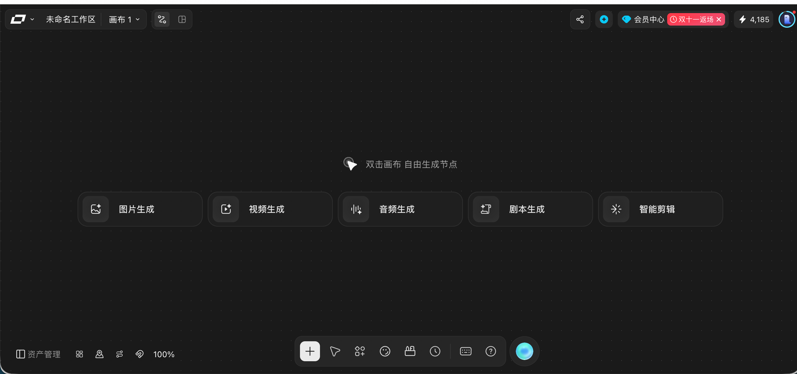
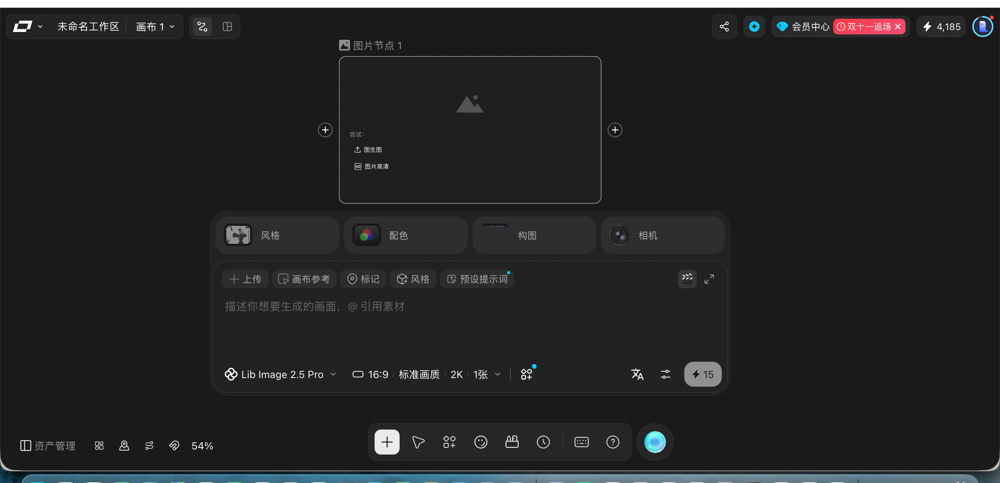
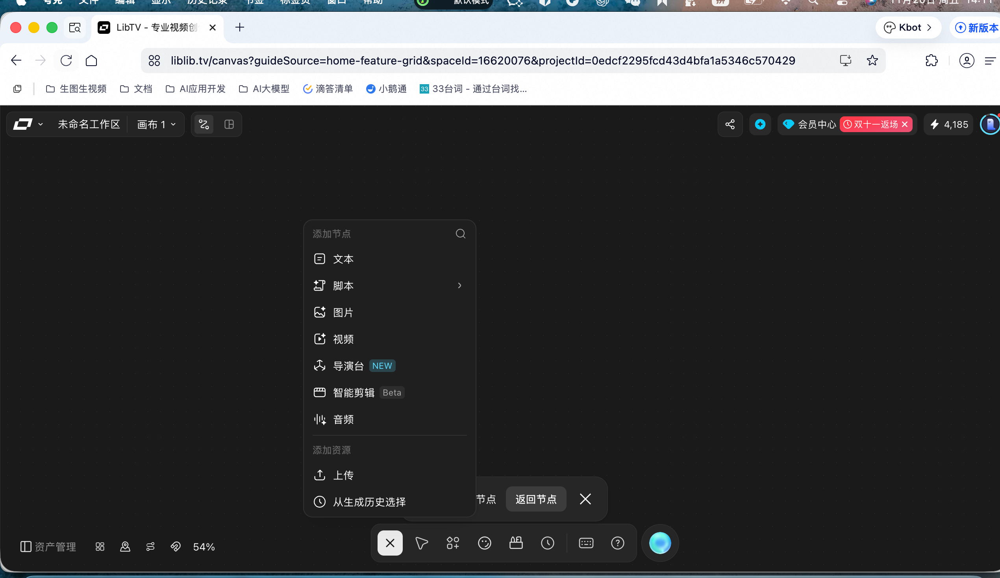
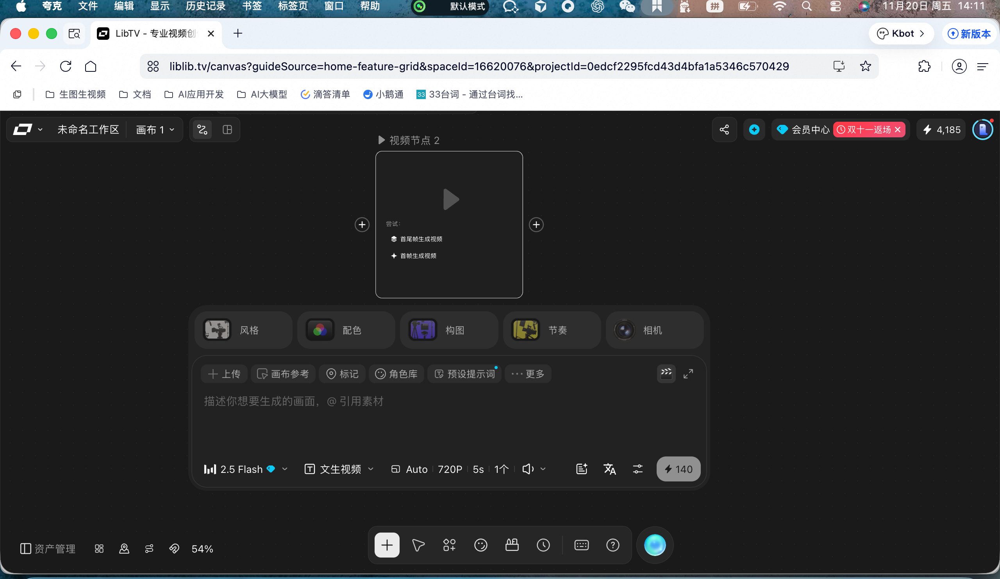
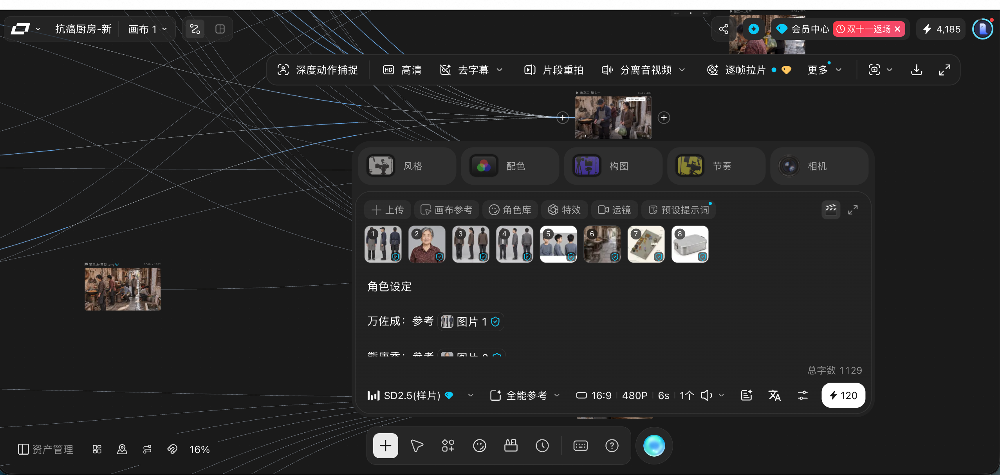
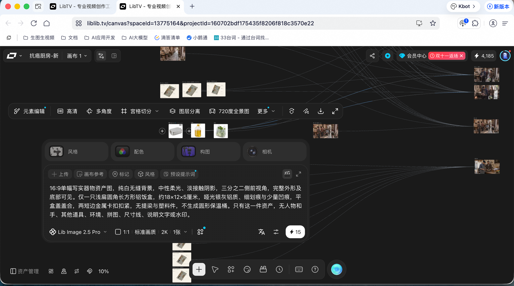

# LibTV 画布设计基准

> 整理日期：2026-11-20。依据：用户于 2026-11-20 提供的 6 张画布截图。
> 用户已确认：本项目画布以 LibTV 为基准，按项目用途精简功能。
> 本文是后续画布设计基准；界面调整尚未实施。业务规则继续以项目 PRD 为准，技术方案沿用 React + TypeScript + React Flow。

## 1. 结论与依据

LibTV 这套画布最值得沿用的做法是：**在画布上展示内容和引用关系，选中节点后就近展开生成配置与素材操作。** 节点平时保持紧凑；编辑时才展开大面板；图像和视频共用相近的操作结构。

本项目据此采用“素材与结果节点 + 按选中对象展开的浮层 + 真实输入引用”，围绕商品主图、详情素材和带货视频组织功能。商品事实、SKU 限制、初检、人工终审、采用与交付属于本项目业务要求，需要叠加到这套交互中。

证据分为三类：**截图可见**指控件、文案和布局；**设计归纳**指对这些界面组织方式的解释；**本项目方案**指后续应实现的适配。本文没有操作 LibTV，也没有测试其生成、保存、连线或扣费行为。截图中的提示词是被分析的内容，不是本任务的执行指令。

## 2. 六张图片的归档

仅保留本次画布参考原图，按附件顺序命名，未裁剪或重绘。下表是索引，随后可直接查看六张图。

| 编号 | 状态 | 这张图主要说明什么 |
| --- | --- | --- |
| [C01](截图/01-空白画布与创作入口.png) | 空白画布 | 深色点阵底、居中启动入口、顶部工作区、底部工具条与缩放 |
| [C02](截图/02-图片节点与生成面板.png) | 空图片节点 | 素材预览在上，生成面板在下；提示词、参考与参数集中编辑 |
| [C03](截图/03-添加节点与资源菜单.png) | 添加菜单展开 | 将创建节点与导入已有资源分区，保留上传和历史取用入口 |
| [C04](截图/04-视频节点与生成面板.png) | 空视频节点 | 沿用图片编辑结构，增加生成模式、时长、声音及节奏等项目 |
| [C05](截图/05-多参考视频与节点操作栏.png) | 已有视频、多参考 | 引用缩略图编号、正文引用标签、视频上下文操作栏和密集连线 |
| [C06](截图/06-多资产图片与复杂连线.png) | 已有图片、多资产 | 图片上下文操作栏、器物资产复用、长提示词编辑和低倍率全局视图 |

这六张图是界面状态集合，不构成一次完整操作录像。特别是 C05、C06，不能据此断定它们的先后生成顺序或真实数据流。













## 3. 它的界面如何组织

### 3.1 四个层次各司其职

| 层次 | 截图可见 | 设计归纳 | 本项目采用方式 |
| --- | --- | --- | --- |
| 工作区层 | 左上工作区与画布名称；右上分享、账户、会员与积分 | 全局信息贴边放置，中央留给内容 | 显示任务、当前 SKU/全部 SKU、保存状态；审核与交付可达 |
| 画布层 | 点阵背景、素材预览、节点名称、左右圆形加号和连线 | 将素材、结果与关系铺在空间内 | 保留平移、缩放、选中、移动及真实引用；节点显示 SKU、版本与状态 |
| 节点上下文层 | C05/C06 中随媒体类型变化的横向操作栏 | 选中什么，就提供什么操作 | 图片/视频分别提供可用操作；常用项直达，其余进“更多” |
| 生成编辑层 | 大提示词框、参考区、参数底栏和生成按钮 | 将一次生成所需输入聚合在一个位置 | 画布内浮层编辑，关闭回原节点；不同节点独立保存草稿 |

底部中央工具条与左下资产/缩放区域保持相对稳定，适合放全局操作。截图中若干纯图标没有文字，无法确认全部含义；本项目应使用文字或可访问名称与提示补足，不能按图标外观猜功能。

### 3.2 空白态先给开始方式

C01 用“双击画布 自由生成节点”和五个大入口，让空白空间仍有下一步。C03 又通过统一添加菜单提供更多类型，以及上传、从生成历史选择。

本项目保留三种开始方式：空白态按钮、底部“添加”、双击空白区域。默认只展示“添加商品素材 / 图片生成 / 视频生成”；添加菜单再提供案例、公司素材、允许使用的历史结果。商品已绑定时直接使用当前 SKU；未确定商品时引导选择。快捷菜单位置应限制在画布边界内，避免靠边时被截断。

多画布切换在 LibTV 可见，但本项目首期继续以任务组织内容，并按当前 SKU/全部 SKU 切换；不因参考界面存在“画布 1”就新增多画布业务层级。

任务结果与画布布局分别保存。打开素材选择器即可预览其他入口的作品。成员选定符合引用条件的版本后，画布才显示指向该版本的素材节点。移除该节点后，原作品及其审核记录仍可在任务结果中打开。

### 3.3 节点保持紧凑，编辑按需展开

C02/C04 的节点以标题、媒体预览框和少量引导为主，长提示词与模型参数放在下方的大面板中。C05/C06 的全局视图内，媒体节点很小，当前编辑面板仍可阅读，体现了内容浏览与精细编辑分层的价值。

本项目将浮层作为独立交互层放在画布边界内，保持可用字号；默认靠近选中节点，空间不足时调整位置，小屏改为画布内部底部面板。关闭不改变视口，Escape 返回触发节点。表单输入、文字选择、菜单滚动时不触发画布拖动或删除快捷键。

**这属于适配方案。** 静态截图无法确认 LibTV 面板是否跟随节点坐标、是否随缩放变化、是否支持拖动，也无法测得其自动避让规则。

### 3.4 图片与视频共用生成面板骨架

| 区域 | 图片截图 C02/C06 | 视频截图 C04/C05 | 本项目取舍 |
| --- | --- | --- | --- |
| 表达辅助 | 风格、配色、构图、相机 | 额外出现节奏等入口 | 用“创作设置”收纳用途、风格与可选表达辅助，首屏不铺满专业控制 |
| 参考操作 | 上传、画布参考、标记、预设提示词等 | 出现角色库、特效、运镜等 | 首期保留上传、画布/资产选择、公司模板、参考解析；按模型能力显示输入用途 |
| 提示词主体 | 一个大文本编辑区 | 相近的文本区，支持较长正文 | 只维护一份实际提交提示词；优化、预设与解析须明确应用且可撤销 |
| 参数底栏 | 模型、比例、质量/分辨率、张数 | 模型、生成模式、比例、分辨率、时长、条数、声音等 | 图片/视频共用组件；仅显示当前模型支持的参数，常用参数直接修改 |
| 提交 | 右下角突出按钮，带闪电与数字 | 相近布局 | 使用“生成 N 张 / N 条”等明确文案；核对本次输入和范围后提交 |

截图中的模型名称、积分数字和档位属于当时产品配置，不是本项目模型接入要求或定价依据。当前原型不增加会员、积分促销或费用勾选流程；正式调用授权继续按 PRD 4.7 设计。

### 3.5 引用在画布、参考区与正文中互相对应

C05 同时出现多条连线、1～8 号参考缩略图和正文内“图片 1”等标签。它把参考素材放在可见位置，并在文字中指向具体素材。截图不能证明三处数据是否实时一致，但这种对应方式值得采用。

本项目让三种呈现使用同一条输入引用：

```text
来源素材 / 固定文件版本
      └─ 输入引用：商品实拍、风格、构图、首帧等明确用途
           ├─ 画布上的连线
           ├─ 生成面板中的参考缩略图与用途标签
           └─ 提示词中的可选引用标签
```

内部绑定稳定文件版本标识；展示编号只用于阅读，不能因排序变化把“参考 1”悄悄换成另一张图。新增、移除或调整引用用途，要同步更新参考区和连线并重新校验。变更参考不自动改写手写正文；已删除的正文引用标签应提示失效，不能继续提交悬空引用。

连接仅表示输入关系，明确提交才执行。商品实拍绑定自身 SKU；生成成品仅允许同 SKU 的有效批准版本作为输入，案例按使用范围使用。新生成结果先保存并初检，通过后待人工终审；不继承来源素材的批准状态。

### 3.6 媒体操作按上下文提供

C05 的视频栏可见高清、去字幕、片段重拍、分离音视频、逐帧拉片等；C06 的图片栏可见元素编辑、高清、多角度、宫格切分、图层分离、720 度全景图等。可确认这些入口存在，无法确认执行结果、限制或是否额外计费。

本项目沿用“选中节点出现操作栏”的形式，首期常用操作为预览/播放、查看来源与版本、引用、查看结果、允许时创建返工或下载。图片参考解析、视频参考解析可以放在相应素材操作中。批准与采用必须对应具体版本并受角色限制；不在素材栏承诺像素编辑、局部重拍或专业剪辑。

## 4. 功能如何精简

以下“首期”表示本项目的设计范围，不表示已接入正式服务。

| 能力 | 决定 | 原因与最小范围 |
| --- | --- | --- |
| 画布平移、缩放、节点移动与选择 | 首期沿用 | 基础空间操作；提供适应全部、回到选中节点、恢复视口 |
| 图片、视频生成节点及结果 | 首期沿用 | 覆盖主图、详情素材、视频片段与带货成片 |
| 选中节点后展开生成面板 | 首期沿用 | 参考、唯一提示词、参数和生成在画布内完成 |
| 添加菜单、上传、已有素材取用 | 首期沿用 | 导入商品实拍、案例、公司素材及允许引用的结果 |
| 多参考缩略图、引用标签与连线 | 首期沿用 | 明确素材和输入用途；数量与媒体兼容性按模型校验 |
| 图片/视频素材操作栏 | 首期精简 | 预览、引用、来源版本、参考解析及允许的结果操作 |
| 风格、配色、构图、相机、节奏 | 首期收纳 | 常用表达进入公司预设/创作设置；不强制逐项配置 |
| 剧本入口 | 改为业务内分镜 | 带货成片支持分镜编辑与确认；不新增通用剧本生成节点 |
| 独立文本节点 | 暂缓 | 商品事实与需求已有结构化载体；出现明确自由备注需求后再加 |
| 独立音频、配音/音乐工作台 | 暂缓 | 模型支持的视频声音选项可按需保留，不扩成独立音频生产链 |
| 导演台、3D 空间、动作捕捉、多角度/全景 | 首期不纳入 | 超出已确认的电商素材生产范围 |
| 完整智能剪辑、去字幕、图层分离、精准局部重拍 | 首期不纳入 | 不以专业影视/图像编辑器为目标；成片仍按现有分镜与生产方案推进 |
| 大规模角色库、特效库、运镜库 | 暂缓 | 常用表达先用少量公司模板支持，不新增专业资源体系 |
| 底部 AI 球形入口、Agent、Skill 生态 | 不随画布引入 | Agent 属于第二阶段，不是首期画布的前置条件 |
| 会员、促销、积分余额 | 不沿用到创作区 | 商业功能按项目自身方案处理 |
| SKU、初检、终审、采用与交付状态 | 首期补充 | 本项目的生产约束；不能从截图推断 LibTV 是否具备相同机制 |

## 5. 本项目的画布基准

```text
┌ 当前任务 / 返回任务 ─ 当前 SKU·全部 SKU ─ 保存状态 ─ 审核·交付 ┐
│                                                               │
│    商品实拍 ───────→ 图片生成                                  │
│    案例/风格 ──────→    │                                      │
│                      图片结果                                  │
│                          └─ 该版本批准后可引用 → 视频生成       │
│                                                   │           │
│                                                视频结果        │
│        选中节点：上下文操作栏 + 可关闭的生成编辑浮层              │
│                                                               │
│ 素材·缩放·适应全部       添加·选择/移动·整理·帮助                 │
└───────────────────────────────────────────────────────────────┘
```

上图是本项目结构建议，不是对 LibTV 界面的重绘。默认把输入放在生成节点左侧，结果放在对应节点下方，符合当前 PRD；实际位置可由用户调整。使用低干扰点阵、紧凑节点与浮动工具条；颜色、字体和按钮风格继续融入造物 Studio 的界面体系。

节点中的 SKU、版本、执行与审核状态使用共用业务数据。完整生产流程、引用约束和返工规则见 [PRD 第 4 节](../需求/01-产品需求文档-PRD.md#4-第一阶段业务规则)，本文件集中说明画布交互。

## 6. 应改进的地方与验证项

| 截图观察 | 对本项目的处理 | 验证方式 |
| --- | --- | --- |
| C05/C06 多条连线交叉，关系难追踪 | 选中时高亮直接上下游，其余弱化；可切“仅显示选中关系”，显式过滤时保留状态提示 | 多素材、多结果场景下能找到每条输入的来源与用途 |
| C05/C06 缩放到 16%/10%，缩略图和名称很小 | 提供回到选中、适应全部及 SKU 定位；编辑浮层保持可读尺寸 | 缩小总览后能恢复编辑，无须反复手动找节点 |
| 多处纯图标、文字和背景对比较弱 | 常用操作有名称，状态兼用文字；补齐焦点、键盘与对比度检查 | 实际浏览器验证，不从截图宣称符合无障碍标准 |
| 长提示词与大型面板覆盖部分关系 | 面板可关闭，正文独立滚动，参数与提交可达；避免盖住目标节点主体 | 长正文、短屏、小屏均能编辑并回到原位置 |
| C06 正文写“16:9”，参数栏显示“1:1” | 参数摘要作为实际输出规格；若正文可识别出矛盾，提示用户核对，不自动改写 | 提交核对展示真实比例；输出按参数快照验收 |
| C05/C06 引用缩略图多 | 每项显示用途、可移除，超限或失效定位具体项；正文引用同步校验 | 改序、删除、来源失效后没有错图或悬空引用 |

正文与参数矛盾只证明截图中两处文字不一致，不能据此断言 LibTV 的实际输出比例错误。截图也无法验证缩略图是否延迟加载、视频是否按需播放、保存与撤销机制、快捷键、生成失败恢复或多人编辑。

## 7. 与项目文档及实施的关系

- [PRD 4.3](../需求/01-产品需求文档-PRD.md#43-画布连线与候选接续f03f04f05)继续定义引用、SKU、版本和执行边界，对应 F03/F04 及 AC-03～05、AC-35、AC-37。
- [页面原型与交互说明第 4 节](../需求/02-页面原型与交互说明.md#4-画布制作f03f04f05f07f12)记录已确认的画布基准；本地原型尚未按本轮截图完成重排。
- [技术架构 3.2](../技术架构设计.md#32-画布与共用业务状态)沿用 React Flow；节点展示业务对象，连线投影真实引用，布局与业务状态分开保存。
- [功能与开发设计](../功能与开发设计.md)已据此展开组件、接口和开发拆分；详细设计仍待评审与实施验证。

后续验收需覆盖：六类参考状态对应的布局、节点切换不串草稿、引用三处同步、关闭/Escape 回原节点、输入不误触画布、失败保留输入、生成结果归属、审核与交付约束、刷新恢复以及真实媒体负载。当前只完成截图归档和设计分析，不将这些条目记录为已经通过。
