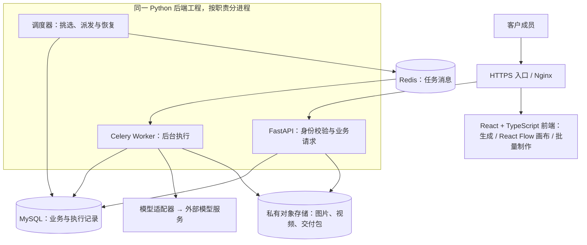

# 造物 Studio｜技术架构设计

> v1.1 · 2026-11-20 · 已确认正式前端采用 React + React Flow；整体架构仍待评审与实施验证。
> 依据：[项目概览](../README.md)、[PRD v4.6](需求/01-产品需求文档-PRD.md)、[页面原型与交互说明](需求/02-页面原型与交互说明.md)。

本文确定系统组成、技术选择、模块边界、运行方式及安全可靠性要求。具体页面行为、接口字段、数据库表结构和开发任务，在架构评审后由[功能与开发设计](功能与开发设计.md)结合需求与原型展开。当前项目仍以本地原型为主，下文描述的是正式产品的目标架构。

## 1. 架构目标与边界

产品围绕“商品资料 → 图片/视频生产 → AI 初检 → 人工终审 → 采用与交付”工作。快捷创作、批量制作和画布使用同一套生产能力，不能各建一套任务、审核和资产系统。

| 必须支持 | 对架构的要求 |
| --- | --- |
| 可销售的正式产品 | 具备身份权限、授权与成本控制、真实文件交付、审计、升级和备份能力 |
| SaaS 与私有化 | 一套代码、同一迁移链；客户隔离与安装方式按部署配置区分 |
| 批量图片与长时视频 | 请求快速返回，后台持续执行；有限并发、超量排队、按输出恢复 |
| 多人协作与版本追溯 | 服务端保存状态，执行输入固定，审核决定绑定具体版本 |
| 后续 Agent | 复用既有业务服务、权限、预算和执行能力，保留人工终审 |

采用**模块化单体 + 独立后台进程**。模块化单体表示业务按职责划分，但仍在一个后端工程中维护；API、调度器和 Worker 按用途分别运行。首期使用 MySQL、Redis、对象存储三类基础设施，规模增长后依据实际瓶颈扩容。

## 2. 总体结构与组件职责

| 组件 | 作用 | 本项目的例子 |
| --- | --- | --- |
| React 前端 | 展示界面、收集输入、呈现真实进度 | 编辑提示词、React Flow 画布、配置批量、人工对照审核 |
| HTTPS 入口 | 统一网站访问、加密传输和请求转发 | 同域提供前端与接口，转发受保护的下载 |
| FastAPI | 提供 API，即供前端访问的服务接口；执行身份与业务校验 | 判断能否提交、批准或下载 |
| MySQL | 可靠保存业务事实及后台执行状态 | 输入快照、输出、审核、用量和供应商调用记录 |
| 调度器 | 按容量选工作，派发消息，发现需要恢复的步骤 | 给大批量逐步派发、安排查单、补发漏发消息 |
| Redis | 作为消息中转，让 Worker 取得待处理工作 | 传递“处理哪个输出的哪个步骤”，不传整段视频 |
| Celery / Worker | Celery 是 Python 任务框架，Worker 是运行它的后台进程 | 调模型、查进度、归档、初检和打包 |
| 模型适配器 | 统一不同供应商的能力和调用差异 | 校验规格、提交生成、查询原请求、取得结果 |
| 对象存储 | 保存大文件，数据库保存其位置和归属 | 实拍原图、生成视频、预览与正式交付包 |

MySQL 是业务状态的依据，Redis 负责传消息。浏览器关闭、Worker 重启或 Redis 消息丢失后，系统依据数据库恢复。前端不能用本机记录替代服务端的批准、授权或完成状态。

## 3. 技术选型

### 3.1 前端

| 技术 | 用途 |
| --- | --- |
| React + TypeScript | 组件化开发，与 React Flow 使用同一前端体系，通过类型约束减少字段误用 |
| Vite + pnpm | 本地开发、生产打包和依赖管理 |
| React Router | 页面与任务导航 |
| TanStack Query | 服务端数据缓存、请求状态与活跃任务轮询，按客户和任务隔离缓存 |
| Zustand | 当前工作区、选中对象和面板等前端共享交互状态 |
| Ant Design | 表单、弹窗、抽屉等通用界面，按现有原型定制风格 |
| React Flow（`@xyflow/react`） | 自定义节点、拖动、平移、缩放、连线与选中交互 |
| Axios | 统一请求、错误、超时和会话处理 |

正式前端于 2026-11-20 确认采用 React Flow，原 Vue 3 / Vue Flow 方案由本版替代。React Flow 使用 xyflow 官方仓库中的 `@xyflow/react` 包；采用统一 React 前端，避免在 Vue 页面中另维护一套 React 运行与状态桥接。

服务端数据按功能封装为请求函数和 React Hooks，由 TanStack Query 管理缓存与刷新；Zustand 不另存一份审核、执行或资产业务事实。局部表单与未保存编辑保留在组件或按对象标识隔离的草稿状态中。当前 HTML/JS 原型作为界面和流程参考，正式界面逐步重建为 React 组件；当前原型尚未迁移或接入 React Flow。

首期通过定时查询获取活跃任务进度，完成后停止；需要即时推送时再评估 SSE，即服务端向浏览器持续发送事件。查询与缓存以客户、任务和业务对象标识隔离，异步结果写回对应对象。退出或切换客户前保存或明确处理未保存草稿，切换时取消旧请求并清理前一客户的缓存和临时输入。

### 3.2 画布与共用业务状态

React Flow 是画布交互层，生产执行、SKU 约束、审核和交付规则由共用应用服务负责。快捷创作与画布映射同一生成对象，批量保留独立清单，三种入口调用同一套业务接口。

| 状态 | 保存与管理方式 | 边界 |
| --- | --- | --- |
| 画布布局与视口 | 节点位置等布局按客户、任务在 MySQL 保存；视口偏好按客户、任务和用户保存，由 React Flow 呈现 | 与业务草稿分别保存、分别检查修改版本，拖动不覆盖提示词或审核决定 |
| 创作草稿与输入引用 | MySQL 保存生成对象、SKU、提示词、参数及来源文件版本/用途，前端共用请求与草稿管理 | 画布节点引用业务对象标识；边投影业务输入引用，不另建一份相互独立的连线事实 |
| 执行、输出与资产版本 | 服务端保存输入快照、执行步骤、文件版本和审核/采用状态，前端按标识查询 | 节点仅显示对应状态；新候选不自动替换已经选择的上游版本 |
| 临时交互 | React 组件及必要的 Zustand 状态保存选中、浮层、拖动中位置和待连接目标 | 临时状态不代表生成已提交、素材已批准或交付已采用 |

节点使用受控的 `nodes` / `edges` 与稳定业务标识映射，节点数据以对象、文件版本标识及必要展示字段为主，不把完整业务记录或媒体二进制复制进画布文档。布局在拖动结束或防抖后保存，失败保留未保存提示；修改版本冲突明确要求重新加载或核对，避免旧页面静默覆盖他人更改。首期支持多人按版本协作，实时共同编辑另行评估。

连线创建、修改与移除通过业务接口更新输入引用。前端先提示 SKU、媒体类型/数量、就绪状态、来源批准/许可和循环依赖问题，服务端在保存及生成提交时再次校验。商品实拍固定绑定自身 SKU；成品仅引用同 SKU 的有效批准版本，案例按使用范围校验。引用保存成功后再作为有效连线，失败保留原关系并定位原因；引用变更使相关分镜确认失效。

连接、断开、移动、缩放和选中仅改变引用或视图，不启动模型调用。用户明确生成后，由业务服务校验并固定本次输入快照，再交给后台执行；结果按客户、任务、生成对象和执行标识关联，不能随当前页面选择写入其他任务。图片 V1 被用于视频后，即使出现图片 V2，视频仍保留 V1 的来源；返工创建新版本，重新初检和终审。

性能重点是媒体和频繁状态更新：自定义节点及回调保持稳定，局部交互只更新受影响节点；图片使用缩略图并按需加载，视频点击后再加载播放内容。按约定节点数、连线数与媒体负载验证首屏、拖动/缩放响应及内存，再决定是否增加可见区域渲染和布局算法。画布内浮层、Escape 返回原节点、小屏面板和输入时的拖动/快捷键冲突均纳入交互验证。首期聚焦素材、生成及结果节点，不扩展通用工作流、像素编辑或完整剪辑器。

### 3.3 后端与基础设施

| 技术 | 用途与理由 |
| --- | --- |
| Python + FastAPI | 业务接口与应用服务，方便复用模型 SDK（供应商调用工具包）及后续 Agent 代码 |
| Pydantic + OpenAPI | 检查输入字段、描述接口约定，并据此生成前端类型 |
| MySQL 8.4 LTS / InnoDB | 团队熟悉；事务和行锁支撑预算、任务、审核及交付一致性 |
| SQLAlchemy + PyMySQL | 前者组织查询与事务，后者连接 MySQL；统一数据库访问方式 |
| Alembic | 记录表结构变更，让 SaaS 与客户私有环境按同一版本顺序升级 |
| Celery + Redis | 承载持久后台工作，结合 MySQL 实现补发、恢复和去重 |
| 对象存储适配层 | SaaS 接云存储；私有化接经验证的客户存储，优先支持 S3 兼容接口 |
| Pillow + ffprobe/FFmpeg | 图片预览、真实媒体规格检测、视频抽帧和必要转码 |
| uv + Docker + CI | 后端依赖管理、统一运行环境、自动检查与镜像构建；CI 指持续集成 |

SQLAlchemy 首期采用同步数据库驱动，放在同步请求处理或受控线程中使用，避免阻塞 FastAPI 的异步处理。每个请求或后台步骤使用独立数据库工作上下文，不跨线程共享。具体依赖版本通过锁文件固定，存储和模型服务通过支持矩阵验证。

## 4. 代码分层与模块边界

后端分为四层：**接口层接收请求 → 应用服务组织业务 → 业务规则判断是否合法 → 基础设施负责数据库、队列、文件和外部调用**。API、Worker 和未来 Agent 共用应用服务，避免同一规则出现多个实现。

| 业务模块 | 负责范围 | 与其他模块的边界 |
| --- | --- | --- |
| 身份与商业授权 | 用户、客户成员、角色、合同权益、用量与预算 | 向所有付费和敏感操作提供统一校验 |
| 商品与公司标准 | 商品事实、实拍依据、案例、模板与发布版本 | 提供可追溯输入，普通变更不改历史版本 |
| 生产执行 | 创作对象、画布布局与输入引用、批量提交、输入快照、输出与步骤调度 | 三入口共用生产规则，画布布局与业务状态分开；调用模型适配层，记录调用与恢复状态 |
| 资产与质量 | 文件版本、来源依赖、AI 初检、人工审核与返工依据 | 对确切版本给出质量与有效性结论 |
| 交付 | 交付需求、版本采用、缺口、打包与下载 | 只使用满足权限、规格及有效批准的资产 |
| 运营运维 | 客户开通、未知调用处理、对账、告警和审计查询 | 与客户管理员权限分开，内容访问须授权留痕 |

模块通过应用服务协作，各模块维护自己的数据写入规则。共用数据库允许关键业务在短事务内一致提交，无需首期引入跨服务事务。

工程组织以 `apps/web` 存放 React 前端、`apps/server` 存放后端模块及 API/调度器/Worker 入口、`deploy` 存放部署和升级资料。具体文件、类和函数划分留给开发设计。

## 5. 批量执行、并发与可靠性

### 5.1 后台执行链路

以 50 个生成项、每项 2 个候选为例：业务校验通过后，MySQL 一次保存输入快照、100 份独立输出及预算等预留；API 随即返回执行编号。调度器分批派发，Worker 在容量内执行，完成文件归档和初检后供人工审核。先完成的可以先查看，一份失败不会使其他 99 份重做。

模型推理分为提交、查询、归档、检查等可恢复步骤。等待供应商处理时退出当前短步骤，到时间再查；不占用数据库事务等待模型返回。页面轮询只查询状态，不推动或控制实际执行。

采用**数据库待执行记录 + 消息队列**：待执行步骤与业务数据一同提交，调度器再向 Redis 发消息。发送中断或消息丢失时可扫描补发；多个调度器用数据库锁与有期限的领取记录避免同时派发同一步骤。

消息可能重复，因此每步按数据库状态去重；旧 Worker 不能覆盖新领取者的结果。幂等是“重复请求仍对应同一业务结果”，不代表外部模型调用天然只发生一次。

### 5.2 并发控制

| 限制 | 作用 | 统一控制位置 |
| --- | --- | --- |
| Worker 并发 | 限制本机同时处理的短任务，保护 CPU、内存和连接 | Celery 与各进程资源配置 |
| 供应商在途并发 | 限制已发出、尚未确认结束的生成，跨所有 Worker 生效 | MySQL 统一保存账户/模型上限与调用占用 |
| 客户并发 | 防止一个客户占满平台容量 | 与供应商额度在同一短事务中原子申请 |
| 请求频率 | 满足每秒/每分钟最多提交或查单次数 | 共享频率控制，首期由 MySQL 记录并协调 |

例如供应商允许 8 份同时生成，每客户上限 4 份：A 提交 100 份、B 提交 20 份，最多各运行 4 份，其余排队。Worker 发出视频后即使空闲，供应商仍在生成，外部占用不能提前释放。生成与初检共享同一账户时，也共同受账户总上限约束。

调度按客户轮转，并限制每个批量提前派发的数量；容量不足就延后，不让 Worker 原地等待。生成、查单/归档、初检、媒体处理/打包按工作类型分配队列及容量，查单和归档保留可用资源。任务框架本机并发配置不能替代跨进程的供应商限制。

并发占用和预算都在数据库短事务中申请、按确认结果释放一次。超时或崩溃导致调用状态未知时，保留相关占用和预留，先查原请求，无法核实进入运营处理。批量大小、排队量和文件体积设置上限，具体数值通过压测与供应商合同确定。

### 5.3 故障处理原则

| 故障 | 架构要求 |
| --- | --- |
| Redis 不可用或消息丢失 | 已接受任务保留在 MySQL，恢复后补发；积压超过接收上限时停止新增 |
| MySQL 不可用 | 暂停新增付费调用及无法验证的敏感操作；已受理调用恢复后查单对账 |
| Worker 中断、消息或回调重复 | 根据步骤状态接续，不重复归档、扣量或释放额度 |
| 超时，不知供应商是否受理 | 查原请求，禁止未经确认再次付费生成；租约到期不能证明调用结束 |
| 文件保存失败 | 重新取得并保存原结果，禁止以重新生成代替保存 |
| 初检异常或覆盖不足 | 重试检查并保留原文件，不能默认通过 |
| 外部存储暂不可用 | 保留结果引用和恢复记录，告警并优先在供应商链接过期前归档 |

生产模型通道需验证供应商幂等键或可靠查单能力、限流规则、结果保留期及费用核实能力。无法安全识别受理情况的通道不能开启自动付费重试。这是供应商接入门槛，单靠 Celery 无法补足。

## 6. 数据、文件与一致性

MySQL 保存客户、业务对象、版本关系、执行步骤、供应商调用、预算分录和审计事件；对象存储保存真实媒体及交付包。关键检索字段使用普通列与索引，变化较大的输入快照等内容可使用 MySQL JSON；首期检索由数据库承担。

| 一致性原则 | 解决的问题 |
| --- | --- |
| 执行输入快照固定 | 商品、模板和草稿后续变化，不改历史调用依据 |
| 画布布局、业务草稿分开保存与检查版本 | 拖动及视口变化不覆盖提示词、输入引用和审核；节点与连线映射共用对象及来源版本 |
| 资产版本不可变 | 返工产生新版本，审核、采用与来源都能定位原件 |
| 多人修改检查版本号 | 拒绝用旧页面覆盖别人刚修改的内容 |
| 关键状态使用事务与唯一约束 | 并发提交、预算预留、审核、补缺及采用不重复生效 |
| 审核与来源有效性分开记录 | 批准不等于永久有效，纠错或许可撤回能阻断后续使用 |
| 商业权益、客户用量、供应商成本分开 | 合同资格、产品收费和外部支出不能混为一个余额 |

数据库事务只覆盖本地数据，不涵盖模型调用与文件存储；外部操作依靠状态记录、重试边界和对账恢复。费用未知必须保留待核实状态，不能记为零或提前返还预留。涉及多类额度的申请采用固定加锁顺序，失败整体释放本次尚未发出的预留。

原件、预览和交付包均使用私有存储。下载经服务端实时校验身份、许可、批准及来源有效性后受控传输，每次新请求与续传重新检查；永久公开地址或可绕过撤回的直链不作为正式下载方式。撤回能阻止后续读取，已经下载的内容无法回收。

## 7. 身份、安全与客户隔离

SaaS 中一个客户公司称为一个租户，以 `tenant_id` 表示数据归属。后端从有效登录身份与成员关系建立可信客户上下文，不能相信前端传来的客户编号。普通查询、后台任务、文件、导出和下载都执行相同隔离检查。

MySQL 租户隔离由应用明确实现：统一数据访问层强制客户条件，跨对象关联校验同属客户，并用数据库约束及跨客户测试补强。平台运营与客户管理员分开授权；同一人属于多个客户时，每次操作仍有明确的当前客户。

身份采用服务端登录会话和安全 Cookie；密码安全哈希存储，写请求防跨站伪造，管理员支持额外登录验证。权限由服务端根据角色与动作判断，成员停用后会话失效。前端隐藏按钮仅改善交互，不能代替授权。

TLS（传输加密）、服务端密钥保护、数据库最小权限、迁移独立权限及审计覆盖两种部署。上传与外部结果取回检查真实类型、大小和访问目标；媒体处理限制资源与执行时间。Redis、MySQL 和 Worker 位于内部网络，队列仅接受受控任务和数据。

## 8. SaaS 与私有化部署

| 事项 | SaaS | 私有化 |
| --- | --- | --- |
| 应用 | 我方运营，多客户共享应用 | 每个客户独立安装 |
| 数据 | 共享数据库，按租户隔离 | 独立 MySQL、Redis 与存储，仍保留客户和权限检查 |
| 模型 | 平台配置，可按合同接客户账户 | 客户配置可达的模型服务与密钥 |
| 产品授权 | 平台维护合同、席位、功能及额度 | 导入签名许可证，支持离线验签与续期文件 |
| 升级运维 | 我方统一发布与备份 | 提供版本化镜像、安装升级工具、恢复资料及责任说明 |

通过 `DEPLOYMENT_MODE=saas|private` 与环境配置控制部署差异，业务代码、镜像和数据库迁移链保持一致。客户差异优先通过已支持的配置表达，避免为每家维护代码分支。

SaaS 采用 HTTPS 入口、至少两个 API 副本和独立 Worker，数据库使用托管高可用能力，Redis 与私有存储按负载配置。私有化提供 Docker Compose 安装方案，可从单机起步，也可接客户独立数据库和存储；API/Worker 分别扩容。单机方案的可用性边界应在交付时明确。

私有化交付包含环境预检、初始化、许可证导入、备份与升级工具、配置说明和脱敏诊断包；支持离线镜像、代理与私有证书。产品授权验签不依赖我方在线服务，签发私钥仅由我方保存。私有化安装不等于可离线生成，完全离线模型需单独验证。

授权过期阻止新付费调用，已发出的继续查单、归档和记账；读取、导出及数据保留按合同策略执行。默认不向我方回传客户内容。首期可人工开通合同与客户，不以在线支付、自助开票为上线前置条件。

## 9. 运维、质量与容量目标

| 能力 | 首期要求 |
| --- | --- |
| 发布升级 | 自动检查和构建，统一版本与迁移；升级前预检备份，验证从上一支持版本升级 |
| 备份恢复 | MySQL 全量与增量日志支持按时间恢复；对象存储版本保护；定期联合恢复演练 |
| 日志审计 | 用客户、任务、输出和调用编号关联定位；关键授权、审核和费用历史只追加并限制篡改权限，日志脱敏 |
| 监控告警 | API 错误、任务积压、Worker 状态、未知调用、归档失败、预算差异和备份失败 |
| 质量验证 | 真实文件规格检查、多模态初检和人工终审分层；按品类评估误放、误拦与无法判断比例 |

恢复后需核对数据库、文件及供应商实际调用，尤其不能重发备份时间点之后已经受理的付费请求。共享库中单客户恢复应先在隔离环境还原、校验再回灌，不能覆盖生产整库。破坏性表结构变更不假设可以直接回滚。

初始设计目标：普通 API 的 p95 ≤500ms，即 95% 请求在此时间内完成；受限批量接受 ≤2 秒。两者均需在明确数据量、提交大小和并发条件下验证，不包含模型推理与文件传输。SaaS 可用性目标为 99.9%，RPO ≤15 分钟（可接受的数据丢失时间）、RTO ≤4 小时（恢复服务时间）；需通过基础设施与演练支撑后才可作合同承诺，私有化按配置确定。

批量吞吐取决于在途上限、请求频率、模型耗时及归档/检查速度，不能用在线人数或 Worker 数直接推导。架构验证至少覆盖多 Worker、多客户下真实重叠执行、超限排队、客户公平性、消息丢失、未知调用及恢复；至少一次在受控真实模型预算下验证，详细压测方案后续制定。

容量增长时，依次观察瓶颈并扩容：增加 API 副本处理请求，增加相应 Worker 处理后台工作，优化数据库索引和连接，再评估更细的存储或数据隔离。增加 Worker 不会自动提高供应商配额；首期无需 Kubernetes、独立搜索、通用工作流或微服务。

## 10. Agent 扩展位置

未来 Agent 作为同一 Python 工程中的应用入口，理解需求、形成计划并调用既有应用服务；权限、预算、后台执行和文件访问仍走同一链路。对话/计划的恢复状态与生产执行状态分开保存，避免恢复对话导致再次付费。

Agent 不直接写业务表、不自批素材，不绕过人工对分镜、范围及终审的要求。首期预留业务服务边界，不提前加入 Agent 框架、向量数据库或多 Agent 系统；具体框架在第二阶段按能力与 MySQL 持久化支持评估。

## 11. 关键架构决策记录

ADR（架构决策记录）用来说明选择及其代价，以下均为当前方案选择，实施前需验证相关边界。

| 决策 | 选择理由 | 代价与重新评估条件 |
| --- | --- | --- |
| 模块化单体、按用途分进程 | 降低部署维护成本，保留长任务隔离和关键事务能力 | 需遵守模块边界；出现独立团队或明确隔离瓶颈后再评估拆服务 |
| React + TypeScript + Python/FastAPI | 已确认采用 React Flow，统一前端体系；Python 便于 AI 能力复用 | 正式界面需重建为 React 组件，数据库与媒体操作需处理阻塞和资源限制 |
| React Flow 负责画布交互，共用服务负责业务 | 复用节点与视口能力，三入口保持相同引用、执行和审核规则 | 仍需实现布局保存、业务映射、引用校验与媒体性能；验证不能以库示例代替 |
| MySQL + SQLAlchemy + Alembic | 匹配团队经验，支持事务及统一升级 | 客户隔离需要显式实现；特殊查询能力出现实际缺口后再评估替代 |
| Celery + Redis + MySQL 执行记录 | 成熟队列配合可恢复的业务状态 | 需要维护 Redis，并实现补发、幂等及未知调用处理 |
| 数据库统一并发与预算预留 | 跨进程限制一致，与业务接收和授权事务配合 | 账户热点可能产生锁竞争，实测出现瓶颈再调整控制实现 |
| 私有对象存储、受控下载 | 保护客户内容，使撤回能阻断后续读取 | 承担传输和鉴权开销，按下载负载扩容 |
| SaaS/私有化共用代码 | 保持功能与升级一致，减少客户分支维护 | 发布需覆盖双模式、许可证及客户环境支持矩阵 |

### 11.1 ADR-001：采用 React Flow 并统一 React 前端

- **状态与日期**：已接受，2026-11-20；用户已确认选用 React Flow，实施与容量验证待执行。
- **背景**：F03/F04 要求素材、生成和结果节点、连线引用、画布内编辑及版本接续；快捷与画布必须共用草稿。当前只有原生 HTML/JS 原型，正式 React 前端尚未实施。
- **决策**：正式前端采用 React + TypeScript + React Flow（`@xyflow/react`）；路由、服务端缓存、本地共享状态及组件库采用 §3.1 的 React 配套方案。画布交互与业务服务分开，后台执行仍遵循本架构的事务、授权和恢复约束。
- **备选与取舍**：Vue Flow 可支持同类节点交互，原 Vue 方案仍有技术可行性；本次按用户选型改用 React Flow。Vue 中嵌入 React 会增加状态桥接成本，自绘引擎会增加交互维护工作，首期均不采用。
- **收益与代价**：统一 React 组件体系，可复用节点、连线与视口能力；需重建原型界面并实现业务节点、布局保存和服务端校验。库选型不代表已经解决任务恢复、质量判断或媒体性能，不据此承诺减少固定人日。
- **验证与重评条件**：按 §3.2 和 §12 验证真实媒体节点、三入口数据一致性及版本恢复；若约定规模下的交互性能或扩展需求无法满足，再评估渲染策略与替代方案。

参考：[React Flow 官方 GitHub](https://github.com/xyflow/xyflow)、[自定义节点](https://reactflow.dev/learn/customization/custom-nodes)、[保存与恢复示例](https://reactflow.dev/examples/interaction/save-and-restore)、[性能建议](https://reactflow.dev/learn/advanced-use/performance)。

## 12. 架构验证与后续设计

架构进入正式开发前，优先验证五项：React Flow 画布能否满足业务交互与媒体负载；模型能否满足真实媒体与查单要求；多 Worker 的并发/预算限制是否正确；SaaS 的跨客户访问是否全部拒绝；私有环境能否独立安装、升级及恢复。验证结果可调整支持范围和容量，不能用原型模拟结果代替。

画布验证覆盖素材/生成/结果节点及画布内编辑、合法与非法引用、快捷/画布切换不丢稿或重复调用、刷新恢复布局和固定来源版本，以及切换任务后旧执行结果的正确归属。保存失败与修改版本冲突必须可见；按约定节点数和媒体规模记录首屏、交互响应与内存，作为容量依据。业务验收对应 PRD AC-03～05、AC-21、AC-35 和 AC-37。

架构评审后，按[功能与开发设计](功能与开发设计.md)的范围，将本架构、PRD 和原型共同转成逐功能的页面状态、接口契约、数据结构、任务状态机、异常处理及开发验收任务。功能规则以 PRD 为依据，页面交互以原型和交互说明核对；发现冲突先澄清并同步文档，不由开发自行选一份覆盖。
