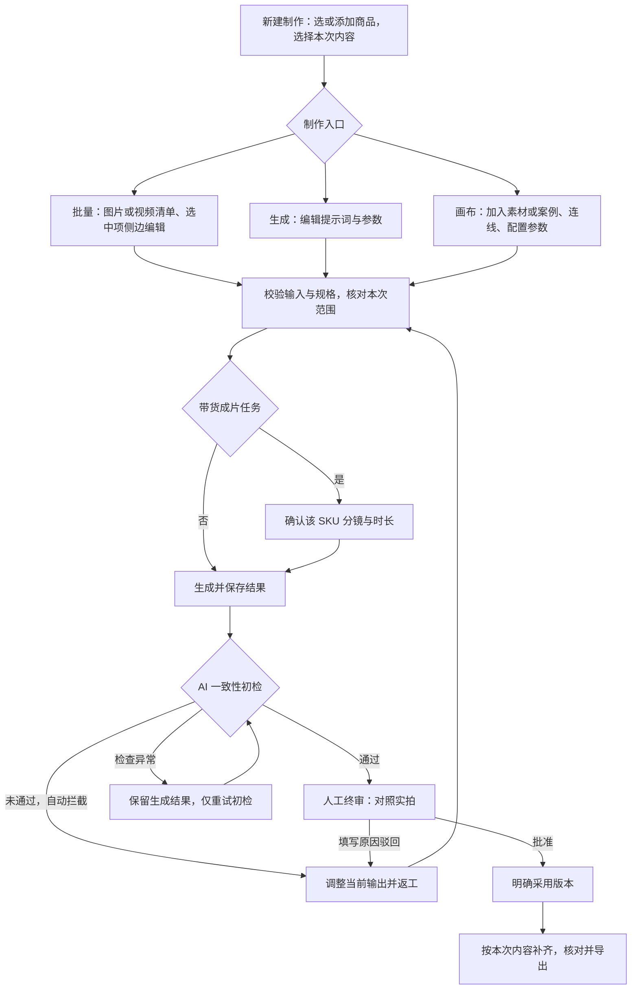

# 电商素材生产工作台｜产品需求文档

> v4.6 · 2026-11-18 · 已按当前原型统一修订 · [概览](../../README.md) · [交互说明](02-页面原型与交互说明.md) · [验收标准](#7-验收标准)

## 0. 本版依据与实现边界

当前交互以 [造物 Studio 原型](../../prototype/index.html) 为准。本版保留最新制作入口、单一提示词、画布内操作与按所选内容交付，并补回“AI 初检→未通过自动拦截、通过后人工终审”。F10 为“一致性初检与自动拦截”；原型仅模拟初检，不具备真实视觉判断能力。

本文同时定义正式产品要求，不能把这些要求视为原型已实现。实现边界如下：

| 范围 | 当前原型 | 正式接入要求 |
| --- | --- | --- |
| 商品与任务 | 本机保存新增商品、实拍、任务和草稿；新建制作先选商品与内容 | 公司资料系统、文件存储与多用户任务 |
| 三种创作入口 | 生成、画布、批量制作；同一份可编辑提示词与直接可达的参数 | 真实模型、媒体输入和能力校验 |
| 执行与视频 | 本地模拟生成、排队和恢复；视频为静态关键帧，分镜可编辑并确认 | 后台队列、关页接续、真实视频及镜头内容验证 |
| 初检、终审与交付 | 预设初检通过/拦截、实拍对照、批准/原因驳回、返工、采用；导出示例 ZIP | 真实一致性检查与文件审核、公司资产、权限、审计和正式下载 |
| 公司标准与资产 | 模板草稿、发布/启停与版本，跨任务检索及批准素材引用，角色限制与停用交接 | 真实账号、服务端权限、公司云存储与可靠审计 |
| 成本与 Agent | 无价格、费用勾选、费用确认及 Agent 入口 | 后台成本记录与授权控制待接入；Agent 属于第二阶段 |

第 4～8 节中的后台、公司级云存储、真实身份与服务端权限/审计、真实媒体解析、区域/时间标注和成本控制均为正式接入要求；当前可体验路径以第 0 节和交互说明为准。原型不因本次文档更新增加费用界面。

## 1. 目标、用户与阶段

面向多行业电商商家、品牌的运营与设计团队，为上新、日常商品展示及营销制作建立“商品实拍与事实→素材生产与保存→人工终审→采用版本→SKU 交付与公司资产”的闭环。业务输出为主图、详情页模块素材及带货视频；每次制作仅要求本次所选内容，具体模块、数量和规格由本次交付清单配置，不预设所有平台采用同一尺寸，不包含店铺详情页搭建或自动发布。

运营确定商品与交付要求，设计人员制作和返工，终审者判断实物一致性及商用适用性，负责人维护公司模板与标准；现有人员可兼任，不增加强制审批层级。

| 阶段 | 范围 | 不依赖什么 |
| --- | --- | --- |
| 第一阶段 | F01～F14、F16～F18：快捷创作、独立批量制作与画布三种入口，含提示词辅助，共用后台执行、公司标准、审核及资产 | 不依赖 Agent 对话、自主规划或用户编排流程 |
| 第二阶段 | F15：Agent 在既有生产能力上理解、推荐、规划和协调 | 不另建商品、任务、审核或资产系统 |

快捷创作处理单个需求；批量制作分别维护图片/视频清单，一次提交多个独立生成项；画布组织引用与依赖。三种入口共用商品、后台任务、审核及资产；快捷与画布可映射同一生成对象，批量独立保留清单，不强制铺成节点。切换入口不自动提交、复制调用或丢草稿，不建设工作流编辑器。第一阶段支持按品类配置商品字段、模板和检查标准，并通过至少两个不同品类验证共用能力；精准局部编辑、单镜头重做另行验证，不混入第一阶段验收。

## 2. 痛点/需求与功能对应关系

### 2.1 需求来源

| 编号 | 客户痛点/需求 | 来源 |
| --- | --- | --- |
| R1 | SKU 多、上新快，主图/详情/视频产能与人头绑定，需控制人力及合格交付成本 | [CASE-021](00-真实案例.md) |
| R2 | 员工各自使用 AI，反复写提示词、调参、盯生成和搬文件，流程仍靠人串联 | CASE-021 |
| R3 | 质量依赖个人经验，缺少可复用的公司标准 | CASE-021 |
| R4 | 素材散落个人电脑，难检索、复用、追溯，换人容易断档 | CASE-021 |
| R5 | 商品、人物与场景需保持商用一致性，实物不能被生成结果改色、改版型或改细节 | CASE-021 |
| R6 | 传统页面与画布均能生成图片/视频，适应不同操作习惯；公司提供默认配置，也允许调整参数 | 本次用户确认，2026-11-12 |
| R7 | 画布支持图片/视频生成、连线引用及取用案例库内容 | 本次用户确认，2026-11-12 |
| R8 | 员工不会写或难以写好提示词，需要快捷风格/用途模板、一键优化，以及从图片/视频参考中提取可复用的表达 | 本次用户提出，2026-11-12；延伸 R2、R3 |
| R9 | 产品面向多行业电商团队，共性生产能力通用，商品字段、表达及质量要求按品类适配，不限制在鞋服 | 本次用户确认，2026-11-12 |
| R10 | 独立于画布批量制作；图片/视频分开，多个独立配置项一次提交、受限并行和排队；编辑时保留多项概览 | 用户确认，2026-11-12～13；B01～B04 及后续布局反馈 |
| R11 | 画布以 LibTV 为设计基准，围绕本项目商品素材生产精简功能；沿用节点、上下文操作、生成浮层和素材引用的组织方式 | 用户确认，2026-11-20；[六张画布截图与拆解](../参考/LibTV/画布设计基准.md) |

R1～R5 的直接业务证据来自鞋服案例，作为跨品类共性问题的初始假设；R9 是产品定位决策，不等于已完成其他行业访谈或验证。

### 2.2 功能与解决方式

下表是需求到产品能力的转译，不表示原案例逐项采购或这些能力已实现。功能编号在各文档中统一使用，验收按[第 7 节](#7-验收标准)逐项执行。

| 功能 | 阶段 | 对应需求 | 如何解决 |
| --- | --- | --- | --- |
| F01 商品事实与实拍管理 | 第一阶段 | R2、R5、R9 | 共用 SKU 资料与来源管理，按品类展示必要字段；不同颜色/规格不混图，卖点有依据 |
| F02 传统页面生成图片/视频 | 第一阶段 | R6；兼顾 R1、R2 | 选商品、素材与配置后直接提交；不必进入画布或手工串生产步骤 |
| F03 画布生成图片/视频 | 第一阶段 | R7；兼顾 R2 | 节点内配置、就地生成和接续，减少跨工具搬运 |
| F04 画布连线引用 | 第一阶段 | R7；兼顾 R2、R5 | 将实拍、案例或选定图片连到生成节点，明确输入用途，减少重复上传和引用错误 |
| F05 案例库检索与取用 | 第一阶段 | R7；兼顾 R3、R4 | 三种入口均能预览、取用图片/视频案例，复用成熟表达并保留来源 |
| F06 公司模板与默认配置 | 第一阶段 | R2、R3、R9 | 按品类维护输入要求、提示词、参数、步骤与检查规则，共用执行机制，员工可沿用适用预设完成生产 |
| F07 生成参数调整 | 第一阶段 | R6、R7；兼顾 R3、R5 | 可调模型、尺寸、清晰度、提示词和视频时长，校验兼容性；单次调整不改公司标准 |
| F08 批量任务、进度与恢复 | 第一阶段 | R1、R2、R10 | 独立图片/视频清单、公共与单项配置、一次提交多个生成项、受限并行和排队、独立结果与失败恢复；编辑不遮断批量概览 |
| F09 带货视频分镜与成片确认 | 第一阶段 | R1、R5 | 按真实卖点、镜头和时长组织成片，不以任意视频片段代替上新交付物 |
| F10 一致性初检与自动拦截 | 第一阶段 | R3、R5、R9 | 按当前 SKU 实拍、事实与规则检查商品、适用人物及场景；未通过自动拦截，通过才可人工终审；异常保留结果待重试 |
| F11 人工终审与结果回写 | 第一阶段 | R3、R5 | 人保留最终品牌审美和商用判断，审核决定绑定具体版本并沉淀 |
| F12 候选比较、标注与返工 | 第一阶段 | R2、R3、R5 | 意见指向确切版本、区域或时间，只重做问题输出，减少沟通及无效生成 |
| F13 公司资产与 SKU 交付 | 第一阶段 | R1、R4 | 所有尝试归公司保存，批准版本可检索、复用并按清单交付，人员变动不丢资产 |
| F14 调用记录与成本控制 | 第一阶段正式接入 | R1、R2 | 后台记录请求、成本与授权范围，防止重复调用；原型不展示价格或费用确认 |
| F15 Agent 辅助生产 | 第二阶段 | R2、R3；兼顾 R1 | 读取既有资料、推荐和组织生产、接续明确反馈，进一步减少人工配置与协调 |
| F16 图片/视频快捷提示词 | 第一阶段 | R8、R9；兼顾 R2、R3 | 按品类、用途和风格提供适用示例卡，结合本 SKU 事实，减少从零写词、错用品类模板和人员差异 |
| F17 一键优化提示词 | 第一阶段 | R8；兼顾 R2、R3 | 将员工的简单描述补成清楚的图片/视频表达，保留原意、可编辑与撤销，不自动开始生成 |
| F18 参考图/视频解析 | 第一阶段 | R8；兼顾 R3、R7 | 从参考中提取构图、风格或镜头/节奏，转成适用于当前 SKU 的提示词草稿，降低“描述不出来”的门槛 |

## 3. 第一阶段生产流程

生成保存后先进行 AI 初检：未通过自动拦截，通过后进入待终审；初检不能代替人工批准。生成失败只重做失败输出，保存失败只重存，初检异常只重试检查，成功结果保留。批准与采用是两步，只有明确采用的批准版本计入交付。上图表示业务流程；当前生成和排队为本地模拟，真实后台执行与成本授权尚待接入。

## 4. 第一阶段业务规则

### 4.0 制作入口、商品与交付范围

- 工作台与“全部任务”页统一使用“新建制作”：先搜索/选择一件或多件商品，再选择本次主图、详情素材或带货视频，名称自动生成且可修改；进入后带入商品资料并聚焦提示词。创建只建立草稿，不启动生成。
- 可在选择商品时添加新商品：上传实拍、填写名称/SKU/已确认信息、核对后保存并自动选中；返回、关闭或 Escape 回到原选择，保留已有商品、内容与名称。商品资料页支持“保存商品”及“保存并开始制作”。当前图片压缩后存于本机，不能宣称已上传公司后台。
- 商品卡片“用此商品制作”开启独立制作选择，取消不改变原任务。向已有任务添加商品必须通过“添加商品到本次制作”明确操作；批量项的商品选项仅限当前任务成员。
- 新任务按商品 × 所选内容建立交付位置，只选主图时不要求补齐详情和视频。后续明确生成其他用途时扩展范围；无范围字段的旧任务沿用主图、详情、视频三类，保留已有采用版本。
- 顶部“全部任务 / 当前任务”用于继续或切换已有任务，任务菜单不放创建入口；审核与交付页保留任务切换和返回创作，不放新建按钮。切换任务恢复创作模式、商品、节点和草稿，当前会话中的模拟执行仍归原任务。

当前每个 SKU 的每种所选用途只计一个交付位置。正式业务的多模块、多张数及规格清单见下文目标要求，尚非原型可配置能力。

### 4.1 商品事实、模板与案例（F01、F05、F06）

- 商品至少含公司、SKU、名称、品类、实拍及任务必需的规格；按用途补齐可辨认的细节，不强制所有商品上传同样张数。卖点记录确认依据与版本，不能编造材质、性能、认证或优惠。缺资料可存草稿，不能执行受影响生成。
- 商品事实是硬约束，品牌规则不能改写商品，案例只影响构图、风格、场景或镜头表达；冲突需修正，不静默忽略。异色/异规格各用自己的商品实拍。
- 公司模板包含用途、必需输入、默认模型/提示词/参数、交付位置与规格、执行和检查规则、人工确认点及失败处理；负责人维护版本和启停。普通员工调整本次参数不改模板，不因保存一张参考图就创建新模板或 Skill。
- 案例库支持搜索、来源/媒体类型筛选、图片预览、视频播放和加入任务。内部公司案例引用有效批准素材；外部案例保存来源、使用范围及媒体文件，范围未确认时可查看但不用于生产。案例可独立作为参考，不要求每个案例绑定可执行模板。
- 切换模板只替换其附带配置与案例，单独选入/上传的素材保留并重新校验；“仅添加案例”不改变当前模板、商品与目标数量。未添加额外案例也可按公司预设生产。

品类适配属于 F01、F06、F10、F16 的配置能力，不为每个行业另建生产系统。商品选择后自动带入适用品类字段、模板、快捷词和检查项；不适用的输入隐藏，不强迫所有商品填写服装尺码、领口等字段。未接通检查或生成能力时明确显示待适配，不能自动套用其他品类规则。

| 品类示例 | 事实与输入要求 | 模板及检查重点 |
| --- | --- | --- |
| 鞋服 | 颜色、版型/轮廓、尺码、结构及已确认材质，必要时附穿着参考 | 穿搭/细节表达，检查版型、颜色、纹理、标识与人物交互 |
| 美妆个护 | 容量、包装形态、标签、色号及已确认成分/功效依据 | 包装/质地展示，检查瓶身、标签、容量及文案，不由视觉推断功效 |
| 家居日用/数码配件 | 尺寸、结构、部件、接口或适配信息及必要比例依据 | 场景/操作展示，检查结构、件数、比例、接口及真实使用方式 |

这些是配置示例，不表示品类已上线。首期选择鞋服和至少一个非鞋服品类实测，同一功能按不同品类资料与标准运行；后续增加品类不依赖第二阶段 Agent。

### 4.2 三种入口与生成配置（F02、F03、F07、F08）

快捷创作可独立完成生产；批量无需画布连线；画布可直接生成。三种入口提供以下业务配置，按草稿、生成项或节点独立保存。字段可用不代表必须同时铺在主界面。

| 配置 | 图片 | 视频 |
| --- | --- | --- |
| 商品与用途 | SKU、主图或详情模块、目标数量 | SKU、视频片段或带货成片、目标数量 |
| 素材 | 实拍、公司素材、图片案例及其引用用途 | 图片/视频参考；首尾帧等按模型能力提供 |
| 模型 | 已接入且允许使用的图片模型 | 已接入且允许使用的视频模型 |
| 尺寸 | 宽高比、目标宽高 | 横竖比例、目标宽高 |
| 清晰度 | 明确分辨率；有独立质量档位时另列 | 明确分辨率；有独立质量档位时另列 |
| 提示词 | 公司预设，可在允许范围内调整 | 公司预设，可调整画面、动作、镜头及节奏 |
| 时长 | 不适用 | 模型支持的时长；成片须符合交付总时长 |

三种入口均只编辑一份实际提交的完整提示词，不再设置“创作描述＋高级完整提示词”两层输入。商品资料自动带入；参考、一键优化/撤销、解析与模型、比例/清晰度、数量、视频时长按需操作，参数可从输入框底部直接修改。快捷与画布的用途和风格放在“创作设置”，批量从商品/用途摘要进入。参数或参考变更不重写手写正文；预设、优化和解析作为明确应用的可编辑建议，不自动生成。恢复默认仅作用于本次配置，不修改公司模板。

同一生成对象切换页面/画布保留输入与单次调整，不复制任务或重提交；新任务使用当前适用预设。已提交调用冻结当时的商品、模板、素材、提示词、模型及参数快照，后续更改不覆盖历史。更改输入、模型或规格后重新校验并核对生成范围，不自动重跑；真实调用的后台授权控制见第 4.7 节。

按模型实际能力校验文件格式/大小/时长/数量、尺寸、清晰度与视频时长。上传中、上传失败或不兼容时定位具体项，保留其余输入；不能静默删参考、换模型或降级输出。实际调用必须传入所选媒体，不以文件名或文字描述代替。

### 4.2.1 批量界面与信息层级

- 桌面采用“紧凑生成项清单＋固定右侧编辑区”。点击编辑或结果只切换右侧内容，不展开行内大表单。公共设置也使用此编辑区。顶部保留一条紧凑任务栏、媒体页签和必要操作，不重复全局栏、大标题或团队选择块。
- 约 1280×600 内容区，在至少五项的条件下，正常编辑、公共设置及查看结果时仍完整可见五项；清单和右侧内容独立滚动，底部提交区保持可见。长提示词、分镜或异常提示可在右侧滚动，不缩小字号硬塞全部控件。
- 清单优先显示画面需求，商品和 SKU 作为辅助信息；右侧以“序号 · 需求摘要”标识当前项。普通编辑为连续输入面板，含商品/用途摘要、自动绑定的实拍、可选参考和唯一完整提示词；业务创作起点在输入框下方，提交快照记录框内原文及单独绑定的商品事实。
- 优化/撤销、模型、清晰度、比例、数量与视频时长集中在输入框底部，取消高级设置页和第二个描述框。修改参数、切换项或选择参考不重新拼接提示词。业务起点与优化/解析只对当前项提供可撤销建议，不改其他项。公共设置说明默认规格及适用范围，底部显示待提交项数、输出总量和带数量的生成按钮。
- 仅显示实际覆盖字段，支持逐字段恢复默认并重新继承公共值，提示词恢复可撤销；整项恢复公共设置及删除放在更多菜单并确认。当前页面没有异常注入或“演示工具”入口，失败时保留结果卡的逐输出重试。
- 带货成片通过单独的分镜确认视图逐项核对。返回编辑保留确认状态；输入、用途、参考、参数或描述变动使该项确认失效。片段不强制分镜，也不直接计成片交付。
- 小于 1100px 使用覆盖式抽屉，手机使用底部面板。支持关闭、Escape、焦点限制与返回触发控件；切项、返回或关面板即时保留草稿，无须额外保存。打开覆盖面板时背景不可操作。

以上借鉴 Lovart 的结果导向、SKU 上下文复用与 LibTV 的减少初始决策、按需深入原则。固定侧边编辑为本项目适配方案，不声称参考产品采用相同布局。

### 4.3 画布连线与候选接续（F03、F04、F05）

画布交互以 [LibTV 画布设计基准](../参考/LibTV/画布设计基准.md)为后续设计基准：采用紧凑媒体节点、选中后展开的上下文操作栏与生成浮层、统一添加菜单及可追踪的参考关系。首期围绕商品素材、图片/视频生成与结果，专业导演台、独立音频、完整剪辑和通用工作流不随参考界面引入。该决策不表示当前原型已完成本轮界面调整。

画布占满工作区，支持素材、图片/视频生成节点与关联结果。节点参数、参考选择、生成确认、视频分镜确认、进度和结果均在画布内呈现；设置浮层不挤压画布，关闭或 Escape 返回原节点。结果出现在对应创作节点下方，可预览、终审或创建返工节点。快捷与画布共享同一节点草稿，按当前 SKU 浏览并可切全部 SKU；批量清单独立维护，不要求铺成节点。正式产品的区域/时间标注和复杂分组能力仍待接入。

连线表示生成输入引用，例如“商品实拍→图片生成”“案例图→风格参考”“选定图片→视频首帧”。记录来源文件、版本、用途与目标；输入未就绪、类型/数量不兼容或形成循环依赖时明确阻止。连线需改变实际生成输入，不是装饰。

商品实拍固定绑定其 SKU；可引用授权允许的案例和同 SKU 已批准素材，不把其他 SKU 成品替换为当前商品，也不以待审或驳回版本充当已批准输入。画布先点来源“引用”，再点目标“输入”，并可移除引用；每个新输出独立进入人工终审，保留来源依赖，来源批准不传递给新版本。

连接、断开、移动、选中、标注和切换视图都不触发生成或付费；修改引用后提示受影响对象，明确点击生成并核对范围才执行。正式调用另须满足后台授权，不要求原型展示费用确认。已选上游版本不因出现新候选自动替换，不自动级联重跑下游。

### 4.4 批量、视频与失败恢复（F08、F09）

批量图片与批量视频分别配置、分别提交；当前默认提交所选媒体的全部未提交项，不设勾选范围。生成项可新增、复制和删除，同 SKU 不同画面也可分别建项。公共设置只影响仍继承字段的未提交项，保留单项覆盖；已提交输入冻结。更换商品清理错 SKU 引用，保留手写内容时要求重新核对事实。

提交前校验所有草稿；任一缺项或不兼容即阻止整次提交，标记对应行并打开该项编辑区，修正或明确删除后再提交，不静默跳过。分别计算项数和候选数，如 3 项 ×（1、2、1 张）= 4 张，不代表四个交付位置。无草稿时禁用主按钮；重复点击不重发在途/完成项。

每项有独立输入快照、执行记录和逐份输出。独立项在真实服务容量内并行，超量自动排队；先完成即可查看，一项失败不阻塞其他项。不在 UI 写死未经验证的并发数。视频优先引用已就绪素材，跨批次依赖自动编排不列为新增必做范围。

一个生产任务可含多个 SKU 与交付位置，不增加项目/批次管理层级。每个位置定义 SKU、用途/模块、规格和所需数量；一个位置可有多候选，生成成功、批准、配齐和下载完成分开统计。

提交前逐 SKU 校验模板适配和必需资料，问题项需修正或明确移除，不静默跳过。正式后台按位置执行、保存并送一致性初检，通过才进入人工终审；刷新或关页不终止后台已接受任务。调用状态不明先查询原请求，未确认失败不得付费重发；保存失败只取回/保存，生成失败只重做该输出。原型按本地记录恢复演示，不具备关页后后台执行或供应商查单能力。

带货成片先确认逐 SKU 分镜，包含连续时段、画面、文案/旁白、事实依据、参考及总时长；分镜草稿可由模板或模型辅助起草。复制镜头结构不能复制其他 SKU 的事实或确认状态；分镜/输入改变只使受影响视频的确认失效。图片不等待全部视频确认。

单段视频探索可直接核对输入、时长与范围后生成，不强制经过完整分镜页；只有满足带货成片清单并通过审核才计入正式视频交付。正式接入须使用确能满足成片要求的服务并校验调用授权，返工以整条视频为单位；不支持的时长或内容要求明确阻止，不用演示片段冒充成片，不承诺镜头级重组。

### 4.5 一致性初检、人工终审与返工（F10、F11、F12）

| 检查维度 | 核心依据 |
| --- | --- |
| 商品 | 实拍对应的颜色、版型/轮廓、比例、结构、纹理、图案、标识、件数及真实卖点 |
| 人物/场景 | 适用的固定形象、人体与商品交互、场景要求、视频跨镜头连续性 |
| 品牌/文案 | 已确认品牌规范、Logo、指定文案与禁用表达，不臆造价格或优惠 |
| 文件/交付 | 约定的尺寸、格式、分辨率、视频时长、模块完整性及文件可打开 |

生成保存后按上表执行一致性初检：商品版型/颜色/细节、适用人物与场景任一必检项不通过则拦截；不适用项标明原因。正式服务未能判断、检查失败或覆盖不足时不能默认放行。通过后才进入人工终审，初检不自动批准或采用。原型展示明确标注的预设模拟结果，不分析真实媒体，不伪造视频采样覆盖。审核中心默认显示当前任务待审，并提供初检中、已拦截、初检异常筛选及数量。桌面并排对照结果与商品实拍，手机上下展示，支持放大，底部操作保持可见；规格、来源和版本记录按需查看。视频原型可编辑并保存分镜，预览使用静态关键帧，真实视频审核能力待接入。必要标识遵守实际服务与交付规则。

拦截记录绑定 SKU、素材版本、实拍依据、规则版本和问题原因；不能批准、采用、引用或交付。检查异常允许只重试初检，保留原文件及依据；初检未通过须调整后生成新版本并重新初检，不允许手动跳过门槛。

终审者只对初检通过的候选对照实拍作批准/驳回，记录人、时间、原因与版本；驳回必填原因。提交决定时再次核对当前版本、人工审核与复核状态，过期或并发冲突不覆盖已有决定。批准撤回须记录原因，不能用选中、喜欢或拖动代替审核。

在页面或画布选定确切版本，驳回必填原因，返工沿用当前输出的 SKU、用途及输入并保留父版本和意见；只重做问题图片或整条视频，新候选重新初检，通过后再人工终审，不继承批准。批准后仍须明确“采用至交付”，可继续下一份待审。区域/视频时间标注为正式接入要求，当前仅有文字原因、放大对照及版本返工，不承诺精准局部编辑。

### 4.6 公司资产、补缺与权限（F13）

所有输入、候选、审核和调用记录归公司保存，按 SKU、品类、场景、用途可检索；默认展示有效批准成品，可查全部生成历史和常用案例。人员停用后资产仍保留，其访问权限失效；商品、任务、文件、审核及下载均按公司和角色校验，不能只靠前端隐藏按钮。

一个交付位置只计一个采用的有效批准版本，同一文件版本不重复填同 SKU 的不同必需位置；多张同一细节图不能代替多个不同模块。缺口按未配齐且无在途/预留的位置计算；分镜待确认占预留，取消未执行计划可释放。重试与补缺提交时重新校验并占用同一位置，防止重复补做。

支持单件、完整包和明确标记的部分包下载，清单列 SKU、用途/规格、采用版本及缺口；服务端在打包和下载时再次检查权限与有效批准状态，撤回后旧下载授权不得绕过限制。部分包不得静默跳过失效文件。

普通资料/模板更新仅影响新选择，停用模板禁止新调用，不自动使既有合格成品失效。商品事实纠错、授权失效、引用素材批准撤回时，关联输出标为需复核，暂停新的调用、终审、下载和引用；已发出调用保留真实费用。负责人记录依据解除阻塞或创建修正版，不把从未批准的素材变成批准，也不追溯回收已下载文件。

### 4.7 调用记录、成本与授权（F14，正式接入）

当前原型不展示价格、费用勾选或费用确认，不调用付费服务。本节为后台正式接入要求，费用授权的具体产品交互另行确认，不要求恢复旧版逐次费用确认弹窗。

正式调用记录请求与供应商请求 ID、输入快照、执行范围、尝试次数、估算/实际成本、预留、待核实与返还状态。图片、视频、分镜辅助、优化与解析分别计费时分别记录；未知费用不记零，未完成返还不显示已退。静态快捷词预览与选择不触发模型。

在公司已授权的预算、模型和调用范围内执行，未获有效授权或无法确定调用成本上界时阻止相应付费步骤。后台预留与结算应避免并发超额，报价变化或额度不足时暂停新增调用。授权机制不代表供应商账单的绝对上限保证。

重复提交、刷新、恢复和补缺不能重复调用或记账；状态不明先查原请求。取消只保证停止未发出的调用，已发出的请求按服务实际能力记录取消和成本状态。再次付费返工必须属于有效授权范围。

### 4.8 提示词辅助（F16～F18）

三项能力适用于快捷创作、选中的批量生成项和画布节点，使用共用规则，均为固定的模型辅助操作，不依赖第二阶段 Agent。它们是可选捷径，员工仍可沿用公司默认配置直接生成；“优质”表示经过公司筛选和验证，不以提示词更长或修饰词更多判定质量。

| 能力 | 输入与产出 | 业务规则 |
| --- | --- | --- |
| F16 快捷提示词 | 按图片/视频、品类、用途、风格显示少量卡片，包含名称、适用范围、示例效果/来源和可预览的提示词 | 选择后将可编辑表达带入当前草稿，商品信息取本 SKU；已有手写内容时显示替换/保留选择。卡片仅改表达，不偷偷切换模型、规格、数量或生产模板 |
| F17 一键优化 | 输入原文、当前用途、已确认商品事实及允许引用的参考；结果填入当前可编辑草稿 | 保留原意及明确的保留项，不增加未知卖点、优惠、品牌或商品结构；保存原文，支持对照和一键撤销。输入为空时引导选模板或填写意图，不替用户猜业务目标 |
| F18 图片参考解析 | 用户上传或选择图片，提取构图、主体位置、可见色调、光线、背景与风格，输出结构化说明及当前 SKU 的提示词草稿 | 不能保证恢复原始提示词、随机种子或真实拍摄参数；不把参考中的商品外形、包装标签、Logo、材质或人物身份写成当前商品事实。不确定项明确标识 |
| F18 视频参考解析 | 用户上传或选择视频，提取镜头时段/顺序、景别、动作、运镜、转场、节奏和可辨认文字，输出分镜表达及视频提示词草稿 | 基于实际视频内容分析，不能只读封面；显示分析时段及采样覆盖，未覆盖部分不宣称已理解。声音仅在具备音轨解析能力时处理；视频风格可借鉴，商品表现不能超出已确认事实 |

解析只生成表达建议，用户预览后选择应用到当前草稿，可继续修改；不自动生成图片/视频，也不自动确认带货成片分镜。仅采用解析文本与同时将原媒体作为模型参考是两种选择：后者须明确加入当前输入，接受媒体能力与使用范围校验，不能暗中上传给生成模型。

优化与解析均保留来源、原文/结果、关联 SKU/用途、所用方法版本、模型、费用及用户采用记录；不自动更新公司模板或案例。异步结果返回时若已切换对象或修改原文，保留为建议，不覆盖新草稿；失败或取消保留原输入，重试只重做辅助步骤，不启动媒体生成。辅助结果不继承任何成品批准，后续素材仍执行完整审核。

视频解析范围按已接入服务明确格式、体积、时长和成本上限；超范围时提示截取支持片段或换文件，不静默只看开头再宣称全片分析。高级镜头组装、还原剪辑工程、复刻音色或身份不属于此功能。

以下为首批卡片文案草案，变量取已确认资料；缺必需事实时提示补充，不凭模板填造。示例效果需使用实际通过审核的内部案例补齐，未验证前不标注为“优质实测”。

| 类型/卡片 | 提示词表达示例 |
| --- | --- |
| 图片·简洁棚拍 | 以当前 SKU 实拍为主体，简洁纯色背景，柔和均匀光线，突出商品轮廓与真实细节，构图留出排版空间。 |
| 图片·生活场景 | 将当前商品放入符合真实用途的生活场景，自然光、干净背景；保持有依据的商品比例与结构，不添加未经确认的使用效果。 |
| 图片·细节特写 | 围绕已选细节部位近景展示，突出实拍可见的纹理与结构，以柔和侧光表现层次；不推断未确认的材质或性能。 |
| 视频·全貌到细节 | 在所选总时长内，先展示商品全貌，再过渡到已确认的重点细节，运镜平稳、节奏清楚，以完整商品画面收尾。 |
| 视频·使用展示 | 按已确认的使用方式展示商品，以自然、合理的动作呈现结构与关键部位，镜头衔接连贯；不编造功能、效果或不支持的使用方式。 |
| 视频·卖点讲解 | 按已确认卖点依次安排商品展示和细节镜头，字幕简短并与画面对应，镜头总长匹配所选时长；没有依据的卖点不补写。 |

鞋服可另配“日常穿搭/上身动态”，美妆可配“包装展示”，家居可配“空间搭配”等品类卡片，只向适用商品展示。以上仅为表达层示例。商品事实、品牌规则与交付规格由系统统一附加为约束；公司验证效果后再维护卡片版本，不把整套约束反复堆进每张卡片。

### 4.9 公司标准、资产与交付配置（本轮原型已实现）

- **模板（F06、F07、F10）**：管理员维护名称、品类、媒体/用途、默认提示词、模型、比例、清晰度、数量/时长及商品/人物/场景初检规则。保存草稿不改变已发布版本；发布前校验字段和媒体兼容性，发布生成不可变版本。停用需确认，阻止新调用；历史结果、已冻结执行与版本记录保留。三个入口明确选择应用，覆盖正文前确认，保留商品事实和独立引用；版本升级不自动覆盖员工草稿。
- **资产（F05、F13）**：公司素材视图检索所有本机任务，支持关键词/SKU、品类、场景、媒体、来源任务筛选，默认只看已批准资产。详情展示来源任务、创建人、SKU、输入/模板版本及审核状态。引用选择目标制作入口，保存来源任务、文件版本及用途；仅有效批准成品可引用，成品只用于同 SKU，不能把源素材批准或采用状态复制到新输出。源版本失效后提交须拒绝并定位。
- **交付（F08、F09、F13）**：每个 SKU 可维护主图、详情模块及视频要求，各项含模块名、数量、比例、清晰度及视频时长；每项展开为独立交付位置。采用时同时校验 SKU、用途/模块、媒体和规格，同一文件版本不可重复填多个位置。修改清单先核对影响，保留仍匹配的采用，清除失配位置但不删除素材。缺口制作带入对应模块/规格；历史单用途单位置平滑迁移，不覆盖原批准决定。
- **分镜（F09）**：快捷、画布、批量共用可编辑分镜，支持添加/删除镜头、时长、画面与文案；各镜头正时长，总和等于所选总时长，未知事实不得添加。确认绑定本次商品、提示词、参考、模板、参数和镜头快照；任一变更使确认失效，切换面板不失效。生成冻结实际镜头，详情、初检和导出说明读取同一份快照；视频仍为模拟，不能称真实成片。
- **权限与交接（F06、F11、F13）**：管理员可管理、创作、终审、采用和下载；设计师可创作、采用和下载；审核员可终审和下载；只读成员只能查看。下载权限可单独关闭。操作处理时再次校验，不能只隐藏按钮。不得停用当前体验身份或移除最后一位管理员；停用成员时选择有效接手人，转移其负责的任务和商品，保留素材创建人、版本、审核和交接记录。身份切换仅是本机演示，不等于真实账号系统。

## 5. 最小业务对象与状态

| 对象 | 必须保留的内容 |
| --- | --- |
| 商品/模板/案例 | 公司、SKU、事实与来源、适用范围、配置、规则、维护人与版本/状态 |
| 任务/交付位置 | SKU、用途/模块/规格、目标、预留、采用版本及补缺状态 |
| 生成对象/画布连线 | 独立草稿与参数、输入文件版本/用途、节点关系与布局；业务状态共用，不另存审核副本 |
| 批量生成项/执行/输出 | 所属任务与媒体、独立草稿、继承/覆盖字段、商品/用途/参考、唯一完整提示词、分镜确认版本；提交冻结快照及执行标识，每份输出独立状态/尝试/文件，关联 SKU 与资产版本 |
| 提示词辅助记录 | 快捷卡版本、原文/优化稿、解析来源及覆盖、适用 SKU、采用/撤销、模型与费用；与媒体生成调用分开记录 |
| 候选/视频分镜 | 文件与父版本、输入快照、分镜及确认版本、初检结果/依据/规则版本、人工终审决定、依赖与复核状态 |
| 调用/交付包 | 请求与费用记录、完整/部分清单、权限校验及下载记录 |

主状态：草稿/待确认→排队→生成→保存→AI 初检→通过后待终审→已批准或已驳回；初检未通过转已拦截，检查异常转初检异常。批准后明确采用才计入交付，采用是独立标记。其他异常包括生成失败、保存失败及正式接入时的撤回/失效。原型历史待审素材重新进入模拟初检，历史人工批准/驳回决定保留并标注“未记录 AI 初检”，不补造通过记录；旧批量已保存结果复用原标识进入初检，不重新生成。调用状态不明单独标记；需复核是阻塞标记，保留原主状态与费用。任务分别统计目标位置、在途、生成成功、批准候选、配齐位置和阻塞，不能用候选总数冒充交付完成。

## 6. 第二阶段：Agent（F15）

Agent 读取有权限的 SKU、模板及最新任务状态，理解自然语言目标、定位必需缺项、推荐已有适配模板/参数，提出可编辑的制作与费用计划。确认后调用第一阶段能力推进生产、汇总阻塞，并依据用户选定版本、区域/时间意见建议修正；指代不清时先澄清，不猜 SKU 或编造商品事实。

人修改过的配置、引用、分镜及采用版本立即进入同一任务，Agent 接续读取最新记录。仅在明确授权的范围、费用和有限轮次内自动推进，超出则停止；不代替人终审，不覆盖历史批准，不用对话“已完成”代替真实文件与审核状态。

第一阶段模板可按需封装为 Agent 可调用的 Skill，不另建首版公司技能页面、技能市场或多 Agent 体系。后台任务进度为真实执行依据，关页后恢复不从聊天历史猜测，也不重复付费生成。

## 7. 验收标准

以下为待执行的正式验收，不是通过记录；原型演示不能抵扣。涉及真实模型、媒体文件、公司后台与成本的条目须在正式接入后验证；AC-33～43 补充制作、公司协作与交付交互回归要求。第一阶段 AC-01～27、AC-29～43 覆盖 F01～F14、F16～F18，第二阶段 AC-28 覆盖 F15，三种入口采用相同业务标准。

### 7.1 第一阶段

| 编号 | 对应功能 | 场景与通过条件 |
| --- | --- | --- |
| AC-01 | F01 | 两个颜色/规格 SKU 引用各自实拍，卖点可追溯；缺必需细节或事实/品牌冲突时保存草稿但阻止受影响生成 |
| AC-02 | F02、F06、F07 | 传统页面分别以公司默认、自定义参数生成图片和单段视频，不进入画布也能查看、返工并进入审核交付 |
| AC-03 | F03、F06、F07 | 画布分别以默认、自定义参数生成图片和视频；多个节点草稿、用途与数量独立，切换及刷新后不串用 |
| AC-04 | F02、F03、F07 | 同一对象在快捷与画布间切换不丢输入或单次调整、不新增任务/调用；恢复默认有效，不改公司模板；四种入口/配置组合采用相同质量标准 |
| AC-05 | F04 | 实拍、案例、选定图片连入目标后，真实请求包含对应文件版本及用途；未就绪、不兼容或循环连接被拦截；选图继续生成视频有效 |
| AC-06 | F05 | 三种入口均可检索、筛选、预览图片/视频案例；加入画布或添加参考后实际可用；外部使用范围未确认时阻止生产 |
| AC-07 | F05、F06 | 添加案例不改模板/数量；切模板保留独立参考；模板附带案例如实展示，保存参考不自动变成新模板；无额外案例也能生产 |
| AC-08 | F06、F07 | 缺输入、上传失败或模型不支持的格式/数量/尺寸/清晰度/时长均明确定位；不静默删输入、换模型或降级；停用模板不能新生成 |
| AC-09 | F08 | 2 SKU×（2 主图＋3 详情＋1 视频）形成12个位置，10张图片可先执行、2条成片逐 SKU 待确认；刷新不丢进度，成功项不重跑 |
| AC-10 | F08、F14 | 在测试环境注入生成失败、保存失败及调用状态不明，分别只恢复正确步骤；状态不明先查单，重复点击/并发恢复不重复付费 |
| AC-11 | F09 | 分镜时段连续、总长匹配且卖点有依据，各 SKU 独立确认；未知事实阻止视频调用；改一个分镜不使无关图片重跑 |
| AC-12 | F09、F13 | 单段视频不强制分镜，不满足成片清单时不计入带货视频交付；完整成片按实际规格检查；能力不支持时拒绝，不展示虚假的局部重做 |
| AC-13 | F10 | 生成保存后先初检，改色/版型/标签、人物及场景问题按规则拦截并显示具体原因；不适用项有说明，判断失败不默认通过。初检中/拦截/异常版本均不能批准、采用、引用或交付；通过后仍待人工终审。检查异常仅重试检查，返工新版本重新初检；原型结果明确标注模拟，不作为真实准确率证据 |
| AC-14 | F11 | 保存且初检通过后才可人工终审，实拍可放大对照；驳回原因必填，决定绑版本；过期/并发决定不覆盖，AI 或画布操作不能代批 |
| AC-15 | F12 | 选定版本并标注图片区域/视频时间后，只重做该输出；保留原文件、意见和父版本，新候选重审且不继承批准，不修改其他 SKU |
| AC-16 | F13 | 生成文件、版本、参数和审核结果进入公司资产，按 SKU/品类/场景/用途可检索；成员停用后资产保留，旧账号与跨公司访问均被拒绝 |
| AC-17 | F08、F13 | 多候选仅采用一个有效批准版本计数；同一版本不重复填不同位置，同模块多图不冒充多个模块；在途和待确认预留不重复补缺，并发补做只生成一份 |
| AC-18 | F13 | 单件/完整/部分下载与实际清单匹配；部分包列缺口；文件撤回/需复核后旧下载授权也被拒绝，不静默跳过失效项 |
| AC-19 | F01、F06、F13 | 普通资料/模板新版本不覆盖历史；纠错、授权撤回或来源素材失效阻塞相关调用/终审/下载/引用；解除复核有依据且不自动批准 |
| AC-20 | F14 | 正式后台记录图片、视频、辅助调用及失败重试成本；未知费用不记零，无有效授权不调用，并发预留不超公司授权；待核实/返还状态真实。原型无费用界面，实际授权交互另行确认 |
| AC-21 | F03、F04、F14 | 连接/断开、拖动、整理、选中、标注和视图切换不收费、不启动调用、不改变审核状态；输入变更不自动重跑下游 |
| AC-22 | F08、F13、F14 | 取消未发出调用释放相应费用及位置预留；已发出调用按供应商能力显示真实费用，不伪装已撤销或免费；已完成文件保留 |
| AC-23 | F16 | 图片/视频按用途选卡并带入当前 SKU 表达，已有输入可保留或替换；单次不改公司模板/模型/规格。三种入口提供相同卡片和应用规则，卡片预览/选择无模型调用；未经验证卡片不标实测优质 |
| AC-24 | F17、F14 | 用简短及带明确保留项的原文优化，保留意图和事实、不增加未知卖点；可对照/撤销，空输入有引导。异步返回不覆盖新输入或其他节点，失败保留原文，费用有记录且不启动媒体生成 |
| AC-25 | F18、F01 | 解析不同风格参考图，输出构图/光线等说明和当前 SKU 草稿；不混入原图商品、Logo 或虚构拍摄参数，不承诺找回原始提示词。预览后才应用，原媒体未明确选入时不传生成服务 |
| AC-26 | F18、F09 | 用封面相近但镜头顺序/节奏不同的视频验证解析差异，结果含时间关系与覆盖范围，未知声音不捏造；超长文件明确拒绝或引导截取，不静默当全片。应用结果不自动确认分镜或生成，失败只重试解析 |
| AC-27 | F01、F06、F10、F16 | 以鞋服及至少一个非鞋服品类完成主图/详情/视频闭环：三种入口按品类展示字段、模板、快捷词和检查依据，不向包装商品套用版型/穿搭要求，已确认参数/标签等保持一致；未适配能力明确提示，两类共用任务、审核及资产机制 |
| AC-29 | F08 | 独立批量图片与视频清单，三项分别配置并输出 1、2、1 份；一次提交正确计 3 项 4 份，无需画布。并发至少为 2 的真实验证条件下两个独立项执行重叠，超过容量排队并自动接续，先完成先查看 |
| AC-30 | F08、F07 | 公共更改仅影响继承字段，单项手写与已提交快照保留；换 SKU 清理引用并核对事实。任一草稿不合法时整次不启动、定位具体项；重复点击/刷新/入口切换不重复请求 |
| AC-31 | F08、F09、F13 | 部分输出失败不阻塞其他项，重试只恢复失败输出/步骤，成功文件与标识保留；视频逐项确认且变更后失效，片段不计成片。结果正确关联 SKU/用途/执行/版本，生成、终审、采用分别计数 |
| AC-32 | F08、F16～F18 | 1280×600 内容区至少五项时，编辑、公共设置与结果查看均保留五行和提交区；默认普通编辑无长表单。只有一个完整提示词框，模型/规格在底部直接修改；商品/用途、参考与分镜按需进入；优化和提示词恢复可撤销，整项恢复需确认，手机抽屉支持焦点循环、Escape 与恢复触发位置 |
| AC-33 | F01、F02 | 新建制作先选/添加商品再选内容，名称自动生成可修改；无商品或内容不能进入。就地添加后返回原选择，关闭/Escape 不丢父级选择；创建不自动生成 |
| AC-34 | F01、F08、F13 | 商品卡片开启独立制作，取消不改旧任务；只有明确添加才能扩充当前任务，批量商品仅列成员。单选主图只建主图位置，后续生成其他用途扩展范围，旧任务范围与采用保留 |
| AC-35 | F02、F03、F07、F08 | 快捷、画布和批量各对象只有一份提交提示词；改参数/参考不覆盖正文。画布内完成设置、确认、结果及返工，关闭回节点；任务切换恢复草稿且原任务结果不串入新任务 |

| AC-36 | F06、F07、F10 | 新增、保存草稿、发布 V1、修改草稿、发布 V2、停用及重新启用可操作；无效字段不能发布，旧版本不可改写；三个入口明确应用并保留独立参考；停用模板阻止新提交，已提交快照不变 |
| AC-37 | F05、F13 | 跨两个任务按 SKU/品类/场景/媒体/来源任务组合筛选并清空；查看来源与版本；同 SKU 已批准素材可引用至快捷、画布及批量，跨 SKU/待审/拦截不能引用，源失效后不能提交 |
| AC-38 | F08、F13 | 单 SKU 配置 2 主图、2 个不同详情模块各 1 张与 1 条视频，得到 5 个位置；分别核对模块和规格；同版本不能重复填位置，失配不能采用；修改清单只移除受影响采用，原文件保留 |
| AC-39 | F09 | 三入口可编辑镜头；空画面、非正时长或时长总和错误阻止确认；编辑后确认失效，切换面板保留；结果/导出保存实际镜头快照，拒绝用默认固定镜头覆盖编辑内容 |
| AC-40 | F06、F11、F13 | 四种角色逐项验证维护、生成、审核、采用、下载权限；禁用或隐藏控件之外，直接操作处理也拒绝越权，身份切换后立即生效 |
| AC-41 | F13 | 停用成员并交接给有效接手人，任务/商品归属转移、资产数量及历史身份/版本不变；停用身份不可选择，自停用及最后管理员降级被拒绝；刷新后保留 |
| AC-42 | F06、F09、F13 | 手机可完成模板编辑、资产过滤/引用、清单配置、分镜编辑及成员交接；弹窗可滚动、操作可见，Escape/取消不误提交，焦点回到触发控件 |
| AC-43 | F06、F08、F13 | 原有任务、草稿、批准与采用记录迁移后保留；公司记录、模板版本、交付清单与分镜刷新后可恢复；本机记录与真实公司后台的边界明确 |

验收留存真实请求、文件、输入与规则版本、费用、审核及下载记录。严重事实错误漏放、未经确认付费、重复调用、丢资产或绕过审核/权限时先修复复验。

### 7.2 第二阶段

**AC-28（F15）：**给出一句上新需求和已选 SKU，Agent 正确引用已知事实、推荐已有模板、只追问关键缺项并形成可编辑计划；确认后调用真实第一阶段能力。人工改参数/参考/分镜后读取最新版本，反馈指向确切素材；超范围/费用/轮次停止，不自批，不虚构局部编辑。关页恢复依据真实记录，不重复调用。与第一阶段同规格基线比较增量收益，未达标时保留页面和画布独立完成生产。

## 8. 交付顺序与效果判断

第一阶段依次接通单 SKU 主图闭环、详情与批量图片、单段视频与带货成片，每步覆盖适用的快捷、批量与画布入口；提示词模板、优化和图片/视频参考解析随相应媒体接入。主图、详情、视频及 AC-01～27、AC-29～43 全部适用场景通过后才算完成，再验证第二阶段 Agent。

试点建议用10个真实 SKU，覆盖鞋服及至少一个非鞋服品类、异色/近似款，比较原人工/个人 AI 流程、快捷创作、批量制作与画布。相同品类使用同批商品、资料、交付规格和审核标准，交错操作顺序并记录熟练度；结果分品类记录，不能以鞋服结果代表其他行业，样本不用于宣称统计显著性。

| 业务指标 | 统计口径 |
| --- | --- |
| 时间与人工 | 准备资料到必需素材批准可交付，区分人工作业、等待和返工 |
| 质量与一致性 | 初检通过/拦截/异常率及误检漏检、首轮人工终审通过率、每位置返工次数、审核耗时及终审后事实错误 |
| 单份合格交付总成本 | 全部调用（含提示词辅助、解析、失败、废稿、重试和检查）＋存储/订阅分摊＋人工成本，除以批准且实际交付数；待核实费单列 |
| 资产复用与交接 | 检索指定 SKU/版本耗时、来源与审核可追溯情况、换人后接续任务成功情况 |
| 提示词与入口收益 | 按入口对比默认、快捷词、优化及解析稿的准备时间、首轮质量和总成本，记录采用/撤销、重复输入及事实误增 |
| Agent 增量收益 | 对比第一阶段同规格基线的人工操作、协调、澄清和接管，不以对话或工具调用次数代表效果 |

业务负责人在试点前确认时间、成本、人工审核质量与错误放行的接受边界。失败样本、人工接管和维护时间全部计入，不预设提效倍数；通过业务底线并达到约定效果后扩量。新增能力须能对应具体重复工作与可测收益，不以竞品功能数量决定范围。
